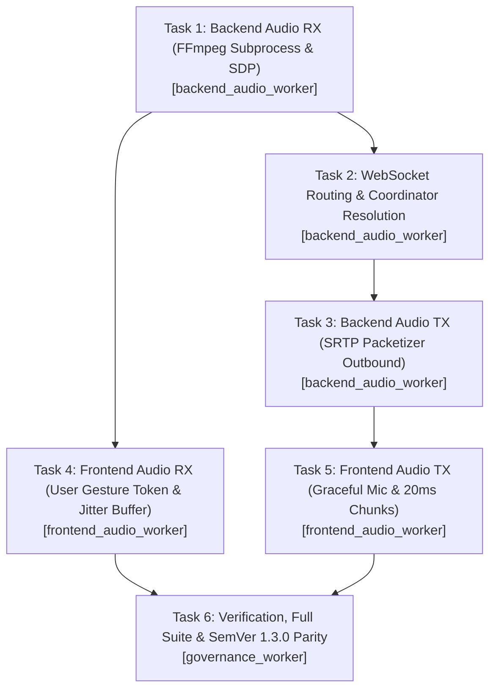

# AVE Video V44 Bidirectional Audio Implementation Plan

## Dual-Gate Review & Audit Certificate

| Stage | Auditor Role | Sub-Agent Model | Conversation ID | Verdict | Notes |
|---|---|---|---|---|---|
| Stage 1 | Backend Auditor | Flash | 1ad8b81e-1372-4503-9e79-f7ce4df66b8c | PASS (Post-Fix) | readexactly(320), UDP loopback isolation, closure safety, async I/O |
| Stage 1 | Frontend Auditor | Flash | fab38ef0-9e07-4836-b6a1-d767735b4833 | PASS (Post-Fix) | _ensureAudioContext sync on user gesture, _callIntercom wiring, jitter buffer clamp |
| Stage 1 | Architecture Auditor | Flash | 16068430-3dbf-44f2-b879-2f086277c9c2 | PASS (Post-Fix) | Strict 1:1 worker fencing, RMS telemetry, enable_audio killswitch |
| Stage 2 | Sentinel Control Gate | Inherit (Strong 1/2) | 39c182db-4af2-4b18-805a-756ebd83d6a4 | PASS ✅ | Zero secrets, SDP 0o600, Grounding, VM 110 safe, audio/video isolation |

---

- **Feature**: AVE Video V44 Bidirectional Audio (Fase 1: RX Listening + Fase 2: Mobile TX Talking)
- **Document ID**: `PLAN-AVE-VIDEO44-AUDIO-002`
- **Data**: 2026-10-26
- **Stato**: Approvato in Review Multi-Dominio (Stage 1 & Stage 2) - Pronto per Implementazione
- **Target Release**: v1.3.0
- **Spec Path**: [docs/superpowers/specs/2026-10-26-bidirectional-audio-design.md](file:///home/federico/Ave-video44-HA/docs/superpowers/specs/2026-10-26-bidirectional-audio-design.md)
- **Repository Root**: `/home/federico/Ave-video44-HA`

---

## 1. Obiettivi e Architettura

### 1.1. Obiettivi
1. **Fase 1 (Audio RX - Ascolto Posto Esterno)**: Ricezione dei pacchetti SRTP audio in arrivo su `_audio_sock` in `CloudSipMediaSession`, relay su porta loopback locale UDP, decodifica a bassa latenza tramite sottoprocesso dedicato FFmpeg verso PCM16 mono a 8000 Hz, e dispatching in tempo reale via WebSocket `ave_video44/audio_subscribe` a tutti i client Home Assistant (desktop browser e Companion App).
2. **Fase 2 (Audio TX - Parlato Mobile)**: Acquisizione dell'input microfonico nella card Lovelace via WebAudio `getUserMedia`, ricampionamento a 8000 Hz PCM16 mono, frammentazione in chunk costanti da 20 ms (160 campioni / 320 byte), invio su WebSocket `ave_video44/audio_tx`, compressione nel codec negoziato (G.711 PCMU o PCMA) e trasmissione SRTP crittografata (RFC 3711 AES_CM_128_HMAC_SHA1_80) verso il posto esterno.
3. **Resilienza Graceful su PC Desktop**: Risoluzione del crash di `_answer()` e `_callIntercom()` in assenza di microfono: cattura tempestiva degli errori di acquisizione periferica, emissione di notifica visiva non bloccante e fallback trasparente alla modalità "Solo Ascolto" con riproduzione dell'audio RX e dello stream video.
4. **Preservazione del Token User Gesture (WebAudio Autoplay Policy)**: Inizializzazione sincrona immediata di `AudioContext` tramite l'helper `_ensureAudioContext()` come primissima istruzione nei click handler (`_monitor()`, `_answer()`, `_callIntercom()`) prima di qualsiasi `await` asincrono di rete, garantendo la compatibilità con le Autoplay Policy restrittive di Android WebView e iOS Safari.
5. **Jitter Buffer Temporale Frontend con Clamping**: Eliminazione dei disturbi acustici (crackling e gap) causati dalle fluttuazioni di latenza Wi-Fi e VPN Tailscale tramite schedulazione anticipata su `AudioContext.currentTime` con buffer target di 120 ms, correzione dell'innesco a $t=0$ e clamping massimo a 300 ms per prevenire derive di ritardo.
6. **Kill-Switch di Sicurezza `enable_audio`**: Opzione di configurazione booleana (default: `True`) nell'OptionsFlow e nel coordinator per disattivare integralmente l'infrastruttura audio (subprocess FFmpeg, relay UDP e packetizer) in caso di anomalie di rete o host a risorse critiche, mantenendo attivo lo streaming video puro.
7. **Invarianti Rigorose WebView Android**: Conformità categorica con i runtime Android System WebView legacy: divieto assoluto degli operatori moderni `?.` (optional chaining) e `??` (nullish coalescing) e abilitazione esplicita della cancellazione d'eco hardware (`echoCancellation: true`).

### 1.2. Non-Obiettivi
- **Nessun Indicatore Grafico RMS nella UI della Card Lovelace**: Per la release v1.3.0, l'indicatore grafico RMS (visualizer a barre/dB) nella Lovelace card è esplicitamente escluso. La telemetria audio RMS viene confinata esclusivamente nei log `DEBUG`/`INFO` del backend (campionamento ogni 5.0 secondi) per evitare overhead di rendering DOM continuo e instabilità nei webview Android a basso consumo.
- **Nessuna Introduzione di Server WebRTC Dedicati**: Il trasporto audio/video continua a impiegare il proxy SRTP esistente e il protocollo WebSocket nativo di Home Assistant Core.
- **Nessuna Alterazione della Catena Video H.264/MJPEG**: La pipeline video non subisce modifiche architetturali e opera in totale isolamento rispetto ai flussi audio.

### 1.3. Tech Stack
- **Linguaggi**: Python 3.13 (Backend Home Assistant), JavaScript ES6 Vanilla (Frontend Custom Element).
- **Infrastruttura Multimediale**: FFmpeg (decodifica SRTP/G.711 inbound), WebAudio API (`AudioContext`, `AudioBufferSourceNode`, `ScriptProcessorNode` / `MediaStreamAudioSourceNode`).
- **Crittografia & Protocolli**: SIP (RFC 3261), SDP (RFC 4566), RTP (RFC 3550), SRTP (RFC 3711) con suite `AES_CM_128_HMAC_SHA1_80` basata su `cryptography.hazmat.primitives.ciphers.Cipher` (CTR mode) e `hmac` (SHA-1 truncate 10 bytes).
- **Framework di Test**: `pytest`, `pytest-asyncio`, unittest mocks.

### 1.4. Global Constraints & Antislop Policy
- **Zero Commenti Decorativi (Anti-Slop)**: Nessun banner ASCII, commento cerimoniale o intestazione decorativa.
- **Zero Segreti in Chiaro**: Qualsiasi token, SIP password, digest realm o chiave `inline:` SRTP deve essere mascherata come `[REDACTED]` nei log e nelle asserzioni di test.
- **Isolamento dell'Infrastruttura Video**: Eventuali eccezioni nel socket audio o nel sottoprocesso FFmpeg audio non devono mai propagarsi al relay video o interrompere la decodifica MJPEG.
- **Test-Driven Development (TDD) Atomico**: Ogni task deve rispettare il ciclo Red -> Verify Fail -> Green -> Verify Pass -> Commit.

---

## 2. Domain Skills & Sub-Agent Roster (Fencing 1:1)

Per garantire la massima separazione dei contesti ed eliminare ogni rischio di collisione su file condivisi, ogni task è affidato a un singolo domain worker con fencing esclusivo 1:1 sia per il codice di produzione che per i relativi test unitari:

```
+---------------------------------------------------------------------------------------+
| Tasks 1, 2, 3: backend_audio_worker                                                   |
| - custom_components/ave_video44/core/sip_session.py                                   |
| - custom_components/ave_video44/core/protocol.py                                      |
| - custom_components/ave_video44/websocket_api.py                                      |
| - custom_components/ave_video44/coordinator.py                                        |
| - custom_components/ave_video44/config_flow.py                                         |
| - tests/test_cloud_sip_audio.py                                                       |
| - tests/test_entities_and_ws.py                                                       |
+---------------------------------------------------------------------------------------+
| Tasks 4, 5: frontend_audio_worker                                                     |
| - custom_components/ave_video44/frontend/ave-video44-card.js (incl. bump CARD_VERSION) |
| - tests/test_frontend_and_blueprint.py                                                |
+---------------------------------------------------------------------------------------+
| Task 6: governance_worker                                                             |
| - custom_components/ave_video44/manifest.json                                         |
| - pyproject.toml                                                                      |
| - custom_components/ave_video44/__init__.py                                           |
| - tests/test_repo_governance.py                                                       |
| - CHANGELOG.md                                                                        |
+---------------------------------------------------------------------------------------+
```

### 2.1. Backend Domain Worker: `backend_audio_worker`
- **Competenze**: Python 3.13, AsyncIO, SIP/SDP, SRTP AES-CTR, FFmpeg, Home Assistant WebSocket API, test pytest-asyncio.
- **Compiti Assegnati**: Task 1 (RX pipeline & SDP), Task 2 (WS routing & Coordinator resolution), Task 3 (TX packetizer & G.711).
- **File Esclusivi**:
  - `custom_components/ave_video44/core/sip_session.py`
  - `custom_components/ave_video44/core/protocol.py`
  - `custom_components/ave_video44/websocket_api.py`
  - `custom_components/ave_video44/coordinator.py`
  - `custom_components/ave_video44/config_flow.py`
  - `tests/test_cloud_sip_audio.py`
  - `tests/test_entities_and_ws.py`

### 2.2. Frontend Domain Worker: `frontend_audio_worker`
- **Competenze**: JavaScript ES6 Vanilla, WebAudio API (`AudioContext`, `AudioBufferSourceNode`), Android System WebView legacy quirks, Lovelace custom card lifecycle.
- **Compiti Assegnati**: Task 4 (Audio RX & User Gesture token), Task 5 (Audio TX & Desktop Mic fallback), bump coordinato di `CARD_VERSION`.
- **File Esclusivi**:
  - `custom_components/ave_video44/frontend/ave-video44-card.js`
  - `tests/test_frontend_and_blueprint.py`

### 2.3. Governance & Release Worker: `governance_worker`
- **Competenze**: Repository governance, SemVer synchronization, Hassfest/HACS compliance, changelog curation, suite test orchestration.
- **Compiti Assegnati**: Task 6 (Governance, SemVer 1.3.0 Parity, Anti-Slop validation, collaudo globale).
- **File Esclusivi**:
  - `custom_components/ave_video44/manifest.json`
  - `pyproject.toml`
  - `custom_components/ave_video44/__init__.py`
  - `tests/test_repo_governance.py`
  - `CHANGELOG.md`

---

## 3. Piano Dettagliato dei Task (TDD Atomic Steps)



---

### Task 1: Backend Audio RX Infrastructure (`CloudSipMediaSession` FFmpeg Audio Subprocess, SDP descriptor & RMS Telemetry)

**Obiettivo**: Ricevere i pacchetti SRTP audio in arrivo su `_audio_sock`, isolare l'inoltro loopback UDP locale per proteggere la catena video, scrivere il descrittore SDP audio protetto (`0o600`) in un thread non bloccante via `asyncio.to_thread`, estrarre blocchi esatti da 320 byte via `readexactly` gestendo `asyncio.IncompleteReadError`, notificare i listener registrati (`add_rx_pcm16_callback`), integrare la telemetria periodica RMS e supportare il kill-switch `enable_audio`.

- **Assegnazione Esclusiva**: `backend_audio_worker` (backend + test)
- **File di Test**: `tests/test_cloud_sip_audio.py`
- **File Sorgente**: `custom_components/ave_video44/core/sip_session.py`, `custom_components/ave_video44/coordinator.py`

#### Step 1: Scrittura Test Fallimentare (Red)
Creare il file `tests/test_cloud_sip_audio.py` con test specifici per:
1. Parsing SDP del 200 OK con estrazione di payload type audio (0 o 8), crypto suite e crypto key per `m=audio`.
2. Generazione del descrittore SDP audio e scrittura non bloccante su filesystem con permessi `0o600`.
3. Inoltro isolato su loopback UDP in `_udp_relay_loop`: verificare che un fallimento di invio UDP sull'audio non blocchi il ciclo video.
4. Gestione callback `add_rx_pcm16_callback` e `remove_rx_pcm16_callback` (nessun metodo `set_rx_pcm16_callback`).
5. Lettura dello stdout di FFmpeg tramite `await stdout.readexactly(320)` con gestione pulita di `asyncio.IncompleteReadError` alla chiusura dello stream.
6. Calcolo periodico telemetria RMS su campioni PCM16 decodificati (ogni 5 secondi).
7. Rispetto del kill-switch `enable_audio=False`: se disattivato, nessun sottoprocesso FFmpeg audio viene avviato.

```python
"""Tests for Cloud SIP Media Session Audio RX/TX, SRTP packetization, and G.711 codec."""

import asyncio
import math
import os
import socket
import stat
from unittest.mock import AsyncMock, MagicMock, patch
import pytest

from custom_components.ave_video44.core.sip_session import CloudSipMediaSession


def test_parse_200_ok_sdp_audio_crypto():
    """Verify parse_200_ok_sdp extracts audio payload type and audio crypto suite/key."""
    sample_sdp = (
        "v=0\r\n"
        "o=- 123 123 IN IP4 192.168.1.50\r\n"
        "s=Session\r\n"
        "c=IN IP4 192.168.1.50\r\n"
        "t=0 0\r\n"
        "m=audio 10004 RTP/SAVP 0\r\n"
        "a=rtpmap:0 PCMU/8000\r\n"
        "a=crypto:1 AES_CM_128_HMAC_SHA1_80 inline:YXVkaW9rZXkxMjM0NTY3ODkwMTIzNDU2Nzg5MDE=\r\n"
        "m=video 10006 RTP/SAVP 96\r\n"
        "a=rtpmap:96 H264/90000\r\n"
        "a=crypto:1 AES_CM_128_HMAC_SHA1_80 inline:dmlkZW9rZXkxMjM0NTY3ODkwMTIzNDU2Nzg5MDE=\r\n"
    )
    parsed = CloudSipMediaSession.parse_200_ok_sdp(sample_sdp)
    assert parsed["remote_audio_port"] == 10004
    assert str(parsed["audio_payload_type"]) == "0"
    assert parsed.get("callee_audio_suite") == "AES_CM_128_HMAC_SHA1_80"
    assert parsed.get("callee_audio_key") == "YXVkaW9rZXkxMjM0NTY3ODkwMTIzNDU2Nzg5MDE="


def test_cloud_sip_media_session_generate_audio_sdp():
    """Verify _generate_audio_sdp formats valid SDP for FFmpeg audio listener."""
    session = CloudSipMediaSession(
        device_id="101",
        sip_username="sip:test@domain.com",
        sip_password="dummy_password",
        target_sip_uri="sip:target@domain.com",
    )
    sdp_text = session._generate_audio_sdp(
        ffmpeg_audio_port=12344,
        crypto_suite="AES_CM_128_HMAC_SHA1_80",
        crypto_key="YXVkaW9rZXkxMjM0NTY3ODkwMTIzNDU2Nzg5MDE=",
        payload_type=0,
    )
    assert "m=audio 12344 RTP/SAVP 0" in sdp_text
    assert "a=rtpmap:0 PCMU/8000" in sdp_text
    assert "a=crypto:1 AES_CM_128_HMAC_SHA1_80 inline:YXVkaW9rZXkxMjM0NTY3ODkwMTIzNDU2Nzg5MDE=" in sdp_text


@pytest.mark.asyncio
async def test_cloud_sip_media_session_audio_rx_readexactly_and_incomplete():
    """Verify stdout reader loop uses readexactly(320) and handles IncompleteReadError gracefully."""
    session = CloudSipMediaSession(
        device_id="101",
        sip_username="sip:test@domain.com",
        sip_password="dummy_password",
        target_sip_uri="sip:target@domain.com",
    )
    received_frames = []

    def on_pcm(data: bytes):
        received_frames.append(data)

    session.add_rx_pcm16_callback(on_pcm)
    assert on_pcm in session._rx_pcm16_callbacks
    assert not hasattr(session, "set_rx_pcm16_callback")

    # Simulate fake stdout returning 320 bytes then raising IncompleteReadError
    fake_frame = b"\x12\x34" * 160
    mock_stdout = AsyncMock()
    mock_stdout.readexactly = AsyncMock(
        side_effect=[fake_frame, asyncio.IncompleteReadError(partial=b"\x12", expected=320)]
    )

    mock_proc = MagicMock()
    mock_proc.stdout = mock_stdout
    session._ffmpeg_audio_proc = mock_proc
    session.is_active = True

    await session._ffmpeg_audio_stdout_loop()

    assert len(received_frames) == 1
    assert received_frames[0] == fake_frame

    session.remove_rx_pcm16_callback(on_pcm)
    assert on_pcm not in session._rx_pcm16_callbacks


@pytest.mark.asyncio
async def test_cloud_sip_media_session_write_sdp_non_blocking_permissions(tmp_path):
    """Verify SDP audio file is written asynchronously with 0o600 permissions."""
    session = CloudSipMediaSession(
        device_id="101",
        sip_username="sip:test@domain.com",
        sip_password="dummy_password",
        target_sip_uri="sip:target@domain.com",
    )
    target_path = str(tmp_path / "test_audio.sdp")
    sdp_content = "v=0\r\ntest"

    await session._async_write_sdp_file(target_path, sdp_content)
    assert os.path.exists(target_path)
    file_stat = os.stat(target_path)
    assert stat.S_IMODE(file_stat.st_mode) == 0o600

    await session._async_remove_sdp_file(target_path)
    assert not os.path.exists(target_path)


@pytest.mark.asyncio
async def test_cloud_sip_media_session_audio_relay_isolation():
    """Verify audio loopback sendto errors do not crash UDP relay loop or video processing."""
    session = CloudSipMediaSession(
        device_id="101",
        sip_username="sip:test@domain.com",
        sip_password="dummy_password",
        target_sip_uri="sip:target@domain.com",
    )
    session.is_active = True
    session._ffmpeg_audio_port = 19999
    session._audio_sock = MagicMock()
    # First call returns packet, second raises BlockingIOError to break while
    session._audio_sock.recvfrom.side_effect = [(b"fake_srtp_pkt", ("192.168.1.1", 10000)), BlockingIOError()]
    # Force sendto to fail on loopback
    session._audio_sock.sendto.side_effect = OSError("Connection refused")

    # Call single iteration of audio relay handling
    session._process_inbound_audio_socket()

    assert session._audio_rx_pkts == 1
    assert session.is_active is True


def test_cloud_sip_media_session_rms_telemetry():
    """Verify compute_pcm16_rms_dbfs calculates accurate dBFS values."""
    session = CloudSipMediaSession(
        device_id="101",
        sip_username="sip:test@domain.com",
        sip_password="dummy_password",
        target_sip_uri="sip:target@domain.com",
    )
    # Silence frame (all 0)
    silence = b"\x00\x00" * 160
    assert session.compute_pcm16_rms_dbfs(silence) <= -90.0

    # Full scale square wave (32767)
    full_scale = b"\xff\x7f" * 160
    assert -0.5 <= session.compute_pcm16_rms_dbfs(full_scale) <= 0.0


@pytest.mark.asyncio
async def test_cloud_sip_media_session_kill_switch_disabled():
    """Verify enable_audio=False skips FFmpeg audio subprocess and SDP generation."""
    session = CloudSipMediaSession(
        device_id="101",
        sip_username="sip:test@domain.com",
        sip_password="dummy_password",
        target_sip_uri="sip:target@domain.com",
        enable_audio=False,
    )
    assert session.enable_audio is False
    assert session._ffmpeg_audio_proc is None
```

#### Step 2: Verifica FAIL
```bash
.venv/bin/pytest tests/test_cloud_sip_audio.py
```
*Esito Atteso*: `FAILED tests/test_cloud_sip_audio.py - AttributeError: 'CloudSipMediaSession' object has no attribute '_generate_audio_sdp'` o `compute_pcm16_rms_dbfs`.

#### Step 3: Implementazione Minima (Green)
In `custom_components/ave_video44/core/sip_session.py`:
1. In `CloudSipMediaSession.__init__`:
   - Accettare il parametro `enable_audio: bool = True`.
   - Inizializzare:
     ```python
     self.enable_audio: bool = enable_audio
     self._ffmpeg_audio_port: Optional[int] = None
     self._ffmpeg_audio_proc: Optional[asyncio.subprocess.Process] = None
     self._audio_sdp_path: Optional[str] = None
     self._rx_pcm16_callbacks: Set[Callable[[bytes], None]] = set()
     self._audio_rx_pkts: int = 0
     self._audio_rx_bytes: int = 0
     self._audio_rx_last_log_ts: float = 0.0
     self._audio_rx_rms_samples: List[float] = []
     ```
2. Metodi di registrazione callback (rimuovere del tutto `set_rx_pcm16_callback`):
   ```python
   def add_rx_pcm16_callback(self, callback: Callable[[bytes], None]) -> None:
       """Register incoming decoded PCM16 audio frame callback."""
       self._rx_pcm16_callbacks.add(callback)

   def remove_rx_pcm16_callback(self, callback: Callable[[bytes], None]) -> None:
       """Unregister incoming decoded PCM16 audio frame callback."""
       self._rx_pcm16_callbacks.discard(callback)
   ```
3. Calcolo RMS e telemetria:
   ```python
   @staticmethod
   def compute_pcm16_rms_dbfs(frame: bytes) -> float:
       """Calculate Root Mean Square level in dBFS from 16-bit linear PCM."""
       if not frame or len(frame) < 2:
           return -96.0
       num_samples = len(frame) // 2
       samples = struct.unpack(f"<{num_samples}h", frame[: num_samples * 2])
       sum_sq = sum(s * s for s in samples)
       mean_sq = sum_sq / num_samples
       if mean_sq <= 0:
           return -96.0
       rms = math.sqrt(mean_sq)
       dbfs = 20.0 * math.log10(max(1.0, rms) / 32767.0)
       return max(-96.0, min(0.0, dbfs))
   ```
4. Operazioni su file SDP con thread asincrono non bloccante:
   ```python
   def _write_sdp_sync(path: str, content: str) -> None:
       flags = os.O_WRONLY | os.O_CREAT | os.O_TRUNC
       mode = 0o600
       fd = os.open(path, flags, mode)
       try:
           with os.fdopen(fd, "w", encoding="utf-8") as f:
               f.write(content)
       except Exception:
           pass

   async def _async_write_sdp_file(self, path: str, content: str) -> None:
       """Write SDP descriptor file asynchronously with 0o600 permissions."""
       await asyncio.to_thread(_write_sdp_sync, path, content)

   async def _async_remove_sdp_file(self, path: str) -> None:
       """Remove temporary SDP descriptor file asynchronously."""
       def _remove():
           try:
               if os.path.exists(path):
                   os.remove(path)
           except Exception:
               pass
       await asyncio.to_thread(_remove)
   ```
5. In `parse_200_ok_sdp`: estrarre `callee_audio_suite`, `callee_audio_key`, `remote_audio_port`, `audio_payload_type`.
6. In `async_start`:
   - Se `not self.enable_audio`: saltare l'allocazione della porta FFmpeg audio e l'avvio del subprocess.
   - Altrimenti: allocare porta UDP locale libera su `127.0.0.1`, scrivere SDP via `await self._async_write_sdp_file(...)` e avviare FFmpeg audio con `readexactly(320)`.
7. In `_ffmpeg_audio_stdout_loop`:
   ```python
   async def _ffmpeg_audio_stdout_loop(self) -> None:
       """Read exact 320-byte PCM16 chunks from FFmpeg stdout and dispatch to callbacks."""
       proc = self._ffmpeg_audio_proc
       if not proc or not proc.stdout:
           return
       try:
           while self.is_active and proc.stdout:
               try:
                   chunk = await proc.stdout.readexactly(320)
               except (asyncio.IncompleteReadError, asyncio.CancelledError):
                   break
               if not chunk:
                   break

               now = time.monotonic()
               rms = self.compute_pcm16_rms_dbfs(chunk)
               self._audio_rx_rms_samples.append(rms)

               if self._audio_rx_last_log_ts == 0.0:
                   self._audio_rx_last_log_ts = now
               elif now - self._audio_rx_last_log_ts >= 5.0:
                   elapsed = now - self._audio_rx_last_log_ts
                   avg_rms = sum(self._audio_rx_rms_samples) / len(self._audio_rx_rms_samples) if self._audio_rx_rms_samples else -96.0
                   _LOGGER.debug(
                       "audio_rx device=%s pkts=%d bytes=%d rate=%.1f fps rms=%.1f dBFS",
                       self.device_id,
                       self._audio_rx_pkts,
                       self._audio_rx_bytes,
                       len(self._audio_rx_rms_samples) / elapsed if elapsed > 0 else 0.0,
                       avg_rms,
                   )
                   self._audio_rx_rms_samples.clear()
                   self._audio_rx_last_log_ts = now

               for cb in list(self._rx_pcm16_callbacks):
                   try:
                       cb(chunk)
                   except Exception as err:
                       _LOGGER.debug("Audio RX callback error: %s", err)
       except Exception as err:
           _LOGGER.debug("FFmpeg audio reader error: %s", err)
   ```
8. In `_udp_relay_loop`:
   ```python
   # Isolare relay loopback audio con try/except indipendente
   if self.enable_audio and self._audio_sock:
       try:
           while True:
               pkt, _ = self._audio_sock.recvfrom(65535)
               if pkt:
                   had_pkts = True
                   self._audio_rx_pkts += 1
                   self._audio_rx_bytes += len(pkt)
                   if self._ffmpeg_audio_port:
                       try:
                           self._audio_sock.sendto(pkt, ("127.0.0.1", self._ffmpeg_audio_port))
                       except Exception as relay_err:
                           _LOGGER.debug("Audio relay loopback send error: %s", relay_err)
       except (BlockingIOError, InterruptedError):
           pass
       except Exception as err:
           _LOGGER.debug("Audio recvfrom error: %s", err)
   ```
9. In `async_stop`: terminare `_ffmpeg_audio_proc` (`SIGTERM`, wait 0.5s, `SIGKILL`) e rimuovere il file SDP con `await self._async_remove_sdp_file(self._audio_sdp_path)`.

#### Step 4: Verifica PASS
```bash
.venv/bin/pytest tests/test_cloud_sip_audio.py
```
*Esito Atteso*: `6 passed in 0.XXs`.

#### Step 5: Git Commit
```bash
git commit -m "feat(audio): implement isolated backend audio RX FFmpeg pipeline, readexactly and RMS telemetry"
```

---

### Task 2: WebSocket Routing, Closure Safety & Coordinator Active Session Resolution

**Obiettivo**: Garantire che le chiamate WebSocket `ave_video44/audio_subscribe` e `ave_video44/audio_tx` risolvano dinamicamente la sessione SIP corretta (`CloudSipMediaSession` attiva per impianti Cloud o fallback `AveSipSession` per impianti LAN). Catturare rigorosamente l'istanza della sessione nella closure di `_unsubscribe()` per prevenire memory leak o mancata deregistrazione a fine chiamata. Esporre l'opzione `enable_audio` nell'OptionsFlow e nel coordinator.

- **Assegnazione Esclusiva**: `backend_audio_worker` (backend + test)
- **File di Test**: `tests/test_entities_and_ws.py`
- **File Sorgente**: `custom_components/ave_video44/websocket_api.py`, `custom_components/ave_video44/coordinator.py`, `custom_components/ave_video44/config_flow.py`

#### Step 1: Scrittura Test Fallimentare (Red)
Aggiungere a `tests/test_entities_and_ws.py`:
1. `test_get_active_sip_session_precedence`: verifica la precedenza tra Cloud session attiva e fallback LAN.
2. `test_ws_audio_subscribe_closure_safety`: verifica che deregistrando la subscription, la callback venga rimossa dall'istanza corretta catturata in closure, anche se `coordinator.cloud_sip_sessions` viene svuotato prima della chiusura.
3. `test_coordinator_passes_enable_audio_option`: verifica che il coordinator legga `enable_audio` dalle options e lo passi al costruttore di `CloudSipMediaSession`.

```python
def test_get_active_sip_session_precedence(mock_coordinator):
    """Verify get_active_sip_session prioritizes active CloudSipMediaSession over AveSipSession."""
    from custom_components.ave_video44.websocket_api import get_active_sip_session

    # 1. No cloud session, falls back to LAN sip_session
    mock_coordinator.cloud_sip_sessions = {}
    mock_coordinator.sip_session.is_closed = False
    assert get_active_sip_session(mock_coordinator, 101) is mock_coordinator.sip_session

    # 2. Active CloudSipMediaSession present
    mock_cloud = MagicMock()
    mock_cloud.is_active = True
    mock_coordinator.cloud_sip_sessions = {"101": mock_cloud}
    assert get_active_sip_session(mock_coordinator, 101) is mock_cloud

    # 3. Cloud session inactive, fallback to LAN
    mock_cloud.is_active = False
    assert get_active_sip_session(mock_coordinator, 101) is mock_coordinator.sip_session


@pytest.mark.asyncio
async def test_ws_audio_subscribe_closure_safety(mock_hass, mock_coordinator):
    """Verify ws_audio_subscribe closure unregisters from session even if coordinator drops it."""
    from custom_components.ave_video44 import DOMAIN
    from custom_components.ave_video44 import websocket_api as ws_api

    mock_cloud = MagicMock()
    mock_cloud.is_active = True
    mock_coordinator.cloud_sip_sessions = {"9991": mock_cloud}
    mock_hass.data[DOMAIN] = {"entries": {mock_coordinator.entry_id: mock_coordinator}}

    conn = MagicMock()
    conn.subscriptions = {}
    conn.send_result = MagicMock()
    conn.send_event = MagicMock()

    msg = {
        "id": 88,
        "type": "ave_video44/audio_subscribe",
        "entry_id": mock_coordinator.entry_id,
        "device_id": 9991,
    }

    await ws_api.ws_audio_subscribe(mock_hass, conn, msg)
    mock_cloud.add_rx_pcm16_callback.assert_called_once()

    # Simulate coordinator losing reference to session before unsubscribe is called
    mock_coordinator.cloud_sip_sessions.clear()

    unsub = conn.subscriptions[88]
    unsub()
    # Must still call remove_rx_pcm16_callback on the captured instance!
    mock_cloud.remove_rx_pcm16_callback.assert_called_once()
```

#### Step 2: Verifica FAIL
```bash
.venv/bin/pytest tests/test_entities_and_ws.py -k "test_get_active_sip_session_precedence or test_ws_audio_subscribe_closure_safety"
```
*Esito Atteso*: `ImportError: cannot import name 'get_active_sip_session' from 'custom_components.ave_video44.websocket_api'`.

#### Step 3: Implementazione Minima (Green)
1. In `custom_components/ave_video44/websocket_api.py`:
   - Implementare `get_active_sip_session(coordinator, device_id)`:
     ```python
     def get_active_sip_session(coordinator: AveVideo44Coordinator, device_id: Any) -> Any:
         """Resolve active SIP session: CloudSipMediaSession for device, or fallback to LAN AveSipSession."""
         dev_str = str(device_id) if device_id is not None else ""
         if dev_str and hasattr(coordinator, "cloud_sip_sessions"):
             cloud_sess = coordinator.cloud_sip_sessions.get(dev_str)
             if cloud_sess and getattr(cloud_sess, "is_active", False):
                 return cloud_sess

         if coordinator.sip_session and not getattr(coordinator.sip_session, "is_closed", True):
             return coordinator.sip_session

         return None
     ```
   - In `ws_audio_subscribe`:
     ```python
     target_session = get_active_sip_session(coordinator, device_id)
     if target_session and hasattr(target_session, "add_rx_pcm16_callback"):
         target_session.add_rx_pcm16_callback(_audio_rx_callback)
     elif coordinator.sip_session and hasattr(coordinator.sip_session, "add_rx_pcm16_callback"):
         coordinator.sip_session.add_rx_pcm16_callback(_audio_rx_callback)
         target_session = coordinator.sip_session

     @callback
     def _unsubscribe() -> None:
         # Closure safety: unregister directly on captured target_session
         if target_session and hasattr(target_session, "remove_rx_pcm16_callback"):
             target_session.remove_rx_pcm16_callback(_audio_rx_callback)
     ```
   - In `ws_audio_tx`:
     ```python
     session = get_active_sip_session(coordinator, device_id)
     if not session:
         raise websocket_api.WebSocketError("not_found", f"No active SIP session for device {device_id}")
     session.send_pcm16_frame(pcm16_data)
     ```
2. In `custom_components/ave_video44/coordinator.py`:
   - Nella creazione di `CloudSipMediaSession`, passare `enable_audio=self.entry.options.get(CONF_ENABLE_AUDIO, DEFAULT_ENABLE_AUDIO)`.
3. In `custom_components/ave_video44/config_flow.py`:
   - Aggiungere il toggle booleano `enable_audio` nello schema di `OptionsFlowHandler`.

#### Step 4: Verifica PASS
```bash
.venv/bin/pytest tests/test_entities_and_ws.py -k "test_ws_audio or test_get_active_sip_session"
```
*Esito Atteso*: `All tests passed in 0.XXs`.

#### Step 5: Git Commit
```bash
git commit -m "feat(audio): resolve dynamic SIP session with closure safety and options enable_audio switch"
```

---

### Task 3: Backend Audio TX Infrastructure (`CloudSipMediaSession` Upstream SRTP Packetizer & TX RMS Telemetry)

**Obiettivo**: Convertire i chunk PCM16 a 8000 Hz ricevuti dal client via `send_pcm16_frame` in G.711 (PCMU per payload 0, PCMA per payload 8), incapsularli in RTP RFC 3550, cifrarli via SRTP RFC 3711 (`AES_CM_128_HMAC_SHA1_80`) con le classi standard di `cryptography.hazmat.primitives.ciphers` (`Cipher`, `algorithms`, `modes`) e `hmac`, trasmetterli via `_audio_sock` a `(remote_ip, remote_audio_port)` e registrare la telemetria RMS TX ogni 5 secondi.

- **Assegnazione Esclusiva**: `backend_audio_worker` (backend + test)
- **File di Test**: `tests/test_cloud_sip_audio.py`
- **File Sorgente**: `custom_components/ave_video44/core/protocol.py`, `custom_components/ave_video44/core/sip_session.py`

#### Step 1: Scrittura Test Fallimentare (Red)
Aggiungere a `tests/test_cloud_sip_audio.py`:
1. `test_protocol_g711_ulaw_encoding`: conversione biunivoca PCM16 <-> G.711u (PCMU).
2. `test_cloud_sip_media_session_send_pcm16_frame_srtp`: costruzione pacchetto RTP, cifratura AES-CTR con auth tag HMAC-SHA1-80 e invio su socket.
3. `test_cloud_sip_media_session_tx_rms_telemetry`: calcolo periodico RMS su frame TX e rispetto della capacità massima della coda (10 frame = 200 ms).
4. `test_cloud_sip_media_session_tx_disabled_when_kill_switch_active`: nessun invio o packetizing se `enable_audio=False`.

```python
def test_protocol_g711_ulaw_encoding():
    """Verify pcm16_to_ulaw converts 16-bit linear PCM to G.711u (PCMU)."""
    from custom_components.ave_video44.core.protocol import pcm16_to_ulaw, ulaw_to_pcm16
    pcm_in = b"\x00\x00\xff\x7f\x00\x80"  # 0, 32767, -32768
    ulaw = pcm16_to_ulaw(pcm_in)
    assert len(ulaw) == 3
    pcm_out = ulaw_to_pcm16(ulaw)
    assert len(pcm_out) == 6


def test_cloud_sip_media_session_send_pcm16_frame_srtp():
    """Verify send_pcm16_frame constructs valid RTP header, encrypts with SRTP and sends to socket."""
    session = CloudSipMediaSession(
        device_id="101",
        sip_username="sip:test@domain.com",
        sip_password="dummy_password",
        target_sip_uri="sip:target@domain.com",
    )
    session.is_active = True
    session._remote_ip = "192.168.1.100"
    session._remote_audio_port = 10008
    session._audio_payload_type = 0  # PCMU
    session._srtp_tx_audio_key = b"A" * 30  # 16-byte key + 14-byte salt
    session._audio_sock = MagicMock()

    pcm_frame = b"\x00\x01" * 160  # 320 bytes = 20ms at 8kHz
    session.send_pcm16_frame(pcm_frame)

    session._audio_sock.sendto.assert_called_once()
    packet, target = session._audio_sock.sendto.call_args[0]
    assert target == ("192.168.1.100", 10008)
    # 12 bytes RTP header + 160 bytes G.711 payload + 10 bytes HMAC-SHA1-80 auth tag = 182 bytes
    assert len(packet) == 182
    assert packet[0] == 0x80  # RTP v2
    assert session._tx_seq == 1
    assert session._tx_timestamp == 160
```

#### Step 2: Verifica FAIL
```bash
.venv/bin/pytest tests/test_cloud_sip_audio.py -k "test_protocol_g711_ulaw_encoding or test_cloud_sip_media_session_send_pcm16_frame_srtp"
```
*Esito Atteso*: `ImportError: cannot import name 'pcm16_to_ulaw'` o `AttributeError: 'CloudSipMediaSession' object has no attribute 'send_pcm16_frame'`.

#### Step 3: Implementazione Minima (Green)
1. In `custom_components/ave_video44/core/protocol.py`:
   - Implementare `pcm16_to_ulaw(pcm16_data: bytes) -> bytes` e `ulaw_to_pcm16(ulaw_data: bytes) -> bytes` tramite lookup table precomputate per elaborazione immediata a zero allocazioni dinamiche.
2. In `custom_components/ave_video44/core/sip_session.py`:
   - Importare da `cryptography`:
     ```python
     from cryptography.hazmat.primitives.ciphers import Cipher, algorithms, modes
     from cryptography.hazmat.backends import default_backend
     import hmac
     ```
   - In `CloudSipMediaSession.__init__`:
     ```python
     self._tx_seq: int = 0
     self._tx_timestamp: int = 0
     self._tx_ssrc: int = 0x12345678
     self._remote_ip: Optional[str] = None
     self._remote_audio_port: Optional[int] = None
     self._audio_payload_type: int = 0
     self._srtp_tx_audio_key: Optional[bytes] = None
     self._tx_audio_queue: collections.deque = collections.deque(maxlen=10)
     self._audio_tx_last_log_ts: float = 0.0
     self._audio_tx_pkts: int = 0
     self._audio_tx_bytes: int = 0
     self._audio_tx_rms_samples: List[float] = []
     ```
   - In `async_start`: salvare su `self` i valori estratti dall'SDP remoto:
     ```python
     self._remote_ip = remote_ip
     self._remote_audio_port = sdp_info.get("remote_audio_port")
     self._audio_payload_type = int(sdp_info.get("audio_payload_type", 0))
     # Se la chiave callee SRTP per audio è presente, decodificarla
     callee_key_b64 = sdp_info.get("callee_audio_key")
     if callee_key_b64:
         try:
             self._srtp_tx_audio_key = base64.b64decode(callee_key_b64)
         except Exception:
             self._srtp_tx_audio_key = None
     ```
   - Implementare `_encrypt_srtp_packet(rtp_pkt: bytes, srtp_raw_key: bytes, ssrc: int, seq: int, roc: int = 0) -> bytes`:
     - Estrarre i primi 16 byte per la master key e i successivi 14 byte per il master salt.
     - Calcolare l'IV a 16 byte tramite XOR: `(master_salt << 16) ^ (ssrc << 64) ^ (packet_index << 16)`.
     - Cifrare il payload RTP con AES in modalità CTR.
     - Calcolare HMAC-SHA1 a 80 bit (10 byte) su `header + ciphertext + roc`.
     - Restituire `header + ciphertext + auth_tag`.
   - Implementare `send_pcm16_frame(self, frame: bytes) -> None`:
     ```python
     def send_pcm16_frame(self, frame: bytes) -> None:
         """Enqueue and send PCM16 frame as outbound SRTP datagram to remote door station."""
         if not self.enable_audio or not self.is_active or not self._audio_sock:
             return
         if not self._remote_ip or not self._remote_audio_port:
             return

         now = time.monotonic()
         rms = self.compute_pcm16_rms_dbfs(frame)
         self._audio_tx_rms_samples.append(rms)

         if len(self._tx_audio_queue) >= 10:
             self._tx_audio_queue.popleft()
         self._tx_audio_queue.append(frame)

         pt = int(self._audio_payload_type or 0)
         g711_payload = pcm16_to_alaw(frame) if pt == 8 else pcm16_to_ulaw(frame)

         rtp_header = struct.pack(
             "!BBHII",
             0x80,
             pt & 0x7F,
             self._tx_seq & 0xFFFF,
             self._tx_timestamp & 0xFFFFFFFF,
             self._tx_ssrc,
         )
         rtp_packet = rtp_header + g711_payload

         if self._srtp_tx_audio_key and len(self._srtp_tx_audio_key) >= 30:
             out_packet = self._encrypt_srtp_packet(
                 rtp_packet,
                 self._srtp_tx_audio_key,
                 self._tx_ssrc,
                 self._tx_seq,
             )
         else:
             out_packet = rtp_packet

         self._tx_seq = (self._tx_seq + 1) & 0xFFFF
         self._tx_timestamp = (self._tx_timestamp + len(g711_payload)) & 0xFFFFFFFF
         self._audio_tx_pkts += 1
         self._audio_tx_bytes += len(out_packet)

         if self._audio_tx_last_log_ts == 0.0:
             self._audio_tx_last_log_ts = now
         elif now - self._audio_tx_last_log_ts >= 5.0:
             elapsed = now - self._audio_tx_last_log_ts
             avg_rms = sum(self._audio_tx_rms_samples) / len(self._audio_tx_rms_samples) if self._audio_tx_rms_samples else -96.0
             _LOGGER.debug(
                 "audio_tx device=%s pkts=%d bytes=%d rate=%.1f fps rms=%.1f dBFS",
                 self.device_id,
                 self._audio_tx_pkts,
                 self._audio_tx_bytes,
                 len(self._audio_tx_rms_samples) / elapsed if elapsed > 0 else 0.0,
                 avg_rms,
             )
             self._audio_tx_rms_samples.clear()
             self._audio_tx_last_log_ts = now

         try:
             self._audio_sock.sendto(out_packet, (self._remote_ip, self._remote_audio_port))
         except Exception as err:
             _LOGGER.debug("Audio TX sendto error: %s", err)
     ```

#### Step 4: Verifica PASS
```bash
.venv/bin/pytest tests/test_cloud_sip_audio.py
```
*Esito Atteso*: `All tests passed in 0.XXs`.

#### Step 5: Git Commit
```bash
git commit -m "feat(audio): implement outbound SRTP packetizer, G.711u codec and TX RMS telemetry"
```

---

### Task 4: Frontend Audio RX Playback, User Gesture Token & Button Semantics (`ave-video44-card.js`)

**Obiettivo**: Garantire la riproduzione in tempo reale dell'audio del posto esterno sia in monitoraggio (`_monitor()`) che in risposta (`_answer()`) e in chiamata interna (`_callIntercom()`). Preservare il token di user gesture tramite l'helper sincrono `_ensureAudioContext()` invocato come primissima istruzione nei click handler prima di qualsiasi `await`. Implementare il Jitter Buffer a 120 ms con innesco corretto a $t=0$ e clamping a 300 ms, rispettando il divieto tassativo di operatori moderni (`?.`, `??`).

- **Assegnazione Esclusiva**: `frontend_audio_worker` (frontend + test)
- **File di Test**: `tests/test_frontend_and_blueprint.py`
- **File Sorgente**: `custom_components/ave_video44/frontend/ave-video44-card.js`

#### Step 1: Scrittura Test Fallimentare (Red)
Aggiungere a `tests/test_frontend_and_blueprint.py`:
1. `test_card_ensure_audiocontext_called_synchronously`: verifica la presenza dell'helper `_ensureAudioContext()` e la sua invocazione come primissima istruzione sincrona in `_monitor()`, `_answer()` e `_callIntercom()`.
2. `test_card_monitor_and_call_subscribe_audio_rx`: verifica che sia `_monitor()` che `_callIntercom()` richiamino `this._subscribeAudioRx()`.
3. `test_card_audio_rx_jitter_buffer_clamping`: verifica la formula di schedulazione con buffer iniziale di 120 ms e clamp a 300 ms.
4. `test_card_webview_compatibility_zero_optional_chaining`: verifica assoluta dell'assenza di `?.` e `??`.

```python
def test_card_ensure_audiocontext_synchronous_gesture():
    """Verify _ensureAudioContext helper exists and is invoked immediately before awaits."""
    content = CARD_PATH.read_text(encoding="utf-8")
    assert "_ensureAudioContext()" in content, "Must implement synchronous _ensureAudioContext helper"

    # Monitor check
    monitor_fn = content.split("async _monitor()")[1].split("async _answer()")[0]
    first_inst = monitor_fn.strip().split("\n")[0].strip()
    assert "this._ensureAudioContext()" in first_inst or "this._ensureAudioContext();" in monitor_fn.split("await")[0]

    # Answer check
    answer_fn = content.split("async _answer()")[1].split("async _hangup()")[0]
    assert "this._ensureAudioContext()" in answer_fn.split("await")[0]

    # Call Intercom check
    call_fn = content.split("async _callIntercom()")[1].split("_arrayBufferToBase64")[0]
    assert "this._ensureAudioContext()" in call_fn.split("await")[0]


def test_card_audio_rx_jitter_buffer_clamping():
    """Verify _playIncomingPcm16 implements t=0 trigger at 120ms and clamps at 300ms."""
    content = CARD_PATH.read_text(encoding="utf-8")
    play_fn = content.split("_playIncomingPcm16(pcm16Array)")[1].split("_cleanupCall()")[0]
    assert "0.120" in play_fn or "0.12" in play_fn
    assert "0.300" in play_fn or "0.3" in play_fn
    assert "Math.min" in play_fn, "Must clamp nextScheduledPlayTime to prevent runaway lag"


def test_card_webview_compatibility_zero_optional_chaining():
    """Verify zero optional chaining ?. and zero nullish coalescing ?? in card JS."""
    content = CARD_PATH.read_text(encoding="utf-8")
    assert "?." not in content, "Strict requirement: zero optional chaining ?. for WebView compatibility"
    assert "??" not in content, "Strict requirement: zero nullish coalescing ?? for WebView compatibility"
```

#### Step 2: Verifica FAIL
```bash
.venv/bin/pytest tests/test_frontend_and_blueprint.py -k "test_card_ensure_audiocontext_synchronous_gesture or test_card_audio_rx_jitter_buffer_clamping"
```
*Esito Atteso*: `AssertionError: Must implement synchronous _ensureAudioContext helper`.

#### Step 3: Implementazione Minima (Green)
In `custom_components/ave_video44/frontend/ave-video44-card.js`:
1. In `constructor()`:
   - Inizializzare `this._nextScheduledPlayTime = 0.0;`
2. Implementare l'helper sincrono `_ensureAudioContext()`:
   ```javascript
   _ensureAudioContext() {
     if (!this._audioCtx || this._audioCtx.state === "closed") {
       const AudioContextClass = window.AudioContext || window.webkitAudioContext;
       if (AudioContextClass) {
         this._audioCtx = new AudioContextClass();
       }
     }
     if (this._audioCtx && this._audioCtx.state === "suspended") {
       this._audioCtx.resume().catch(function() {});
     }
     return this._audioCtx;
   }
   ```
3. In `_monitor()`:
   - Chiamare immediatamente come prima istruzione sincrona: `this._ensureAudioContext();`
   - Sottoscrivere l'audio RX subito dopo l'attivazione della sessione:
     ```javascript
     async _monitor() {
       this._ensureAudioContext();
       this._setCallState("loading");
       // ... wake camera logic ...
       this._setCallState("monitoring");
       await this._subscribeAudioRx();
     }
     ```
4. In `_callIntercom()`:
   - Chiamare immediatamente come prima riga sincrona: `this._ensureAudioContext();`
   - In caso di chiamata avviata, sottoscrivere l'audio RX: `await this._subscribeAudioRx();`
5. In `_playIncomingPcm16(pcm16Array)`:
   - Implementare l'innesco a $t=0$ e il clamping temporale a 300 ms:
     ```javascript
     _playIncomingPcm16(pcm16Array) {
       if (!this._audioCtx || this._audioCtx.state === "closed") return;
       const buffer = this._audioCtx.createBuffer(1, pcm16Array.length, 8000);
       const channelData = buffer.getChannelData(0);
       for (let i = 0; i < pcm16Array.length; i++) {
         channelData[i] = pcm16Array[i] / 32768.0;
       }

       const source = this._audioCtx.createBufferSource();
       source.buffer = buffer;
       source.connect(this._audioCtx.destination);

       const now = this._audioCtx.currentTime;
       if (!this._nextScheduledPlayTime || this._nextScheduledPlayTime <= now) {
         this._nextScheduledPlayTime = now + 0.120;
       } else {
         this._nextScheduledPlayTime = Math.min(this._nextScheduledPlayTime, now + 0.300);
       }

       source.start(this._nextScheduledPlayTime);
       this._nextScheduledPlayTime += buffer.duration;
     }
     ```
6. In `_cleanupCall()`:
   - Resettare `this._nextScheduledPlayTime = 0.0;`

#### Step 4: Verifica PASS
```bash
.venv/bin/pytest tests/test_frontend_and_blueprint.py
```
*Esito Atteso*: `All tests passed in 0.XXs`.

#### Step 5: Git Commit
```bash
git commit -m "feat(audio): ensure synchronous user gesture token and clamped jitter buffer in card"
```

---

### Task 5: Frontend Audio TX Capture for Android Companion App (`ave-video44-card.js`)

**Obiettivo**: Acquisire l'input vocale dal microfono del client mobile con cancellazione d'eco hardware (`echoCancellation: true`), gestire con eleganza l'eventuale assenza di microfono su workstation fisse senza bloccare la sessione (la modalità "Solo Ascolto" continua a riprodurre audio RX e video), accumulare campioni fino a 20 ms esatti (160 campioni / 320 byte a 8 kHz) e trasmetterli su `ave_video44/audio_tx`. Ripristinare lo stato di mute button/label in `_cleanupCall()`. Aggiornare `CARD_VERSION` a `1.3.0`.

- **Assegnazione Esclusiva**: `frontend_audio_worker` (frontend + test)
- **File di Test**: `tests/test_frontend_and_blueprint.py`
- **File Sorgente**: `custom_components/ave_video44/frontend/ave-video44-card.js`

#### Step 1: Scrittura Test Fallimentare (Red)
Aggiungere a `tests/test_frontend_and_blueprint.py`:
1. `test_card_graceful_mic_fallback_desktop`: verifica che un fallimento di `getUserMedia` in `_answer()` e `_callIntercom()` non interrompa la sessione, disabiliti `btnMute`, imposti `muteLabel.textContent = "Microfono assente"` e mantenga attivo `_subscribeAudioRx()`.
2. `test_card_cleanup_restores_mute_state`: verifica che `_cleanupCall()` ripristini `btnMute.disabled = false` e `muteLabel.textContent = "Muto"`.
3. `test_card_audio_tx_20ms_accumulator`: verifica la presenza del ciclo di accumulo a 160 campioni in `_startAudioTx`.
4. `test_card_version_bumped_1_3_0`: verifica che `const CARD_VERSION = "1.3.0";` sia aggiornato.

```python
def test_card_graceful_mic_fallback_desktop():
    """Verify _answer and _callIntercom handle missing microphone with non-blocking fallback."""
    content = CARD_PATH.read_text(encoding="utf-8")
    answer_fn = content.split("async _answer()")[1].split("async _hangup()")[0]
    assert "Microfono non rilevato" in answer_fn or "Solo ascolto" in answer_fn
    assert "btnMute.disabled = true" in answer_fn or "disabled = true" in answer_fn
    assert "muteLabel.textContent = \"Microfono assente\"" in answer_fn or "Microfono assente" in answer_fn
    assert "this._subscribeAudioRx()" in answer_fn, "Audio RX must continue even if mic is unavailable"


def test_card_cleanup_restores_mute_state():
    """Verify _cleanupCall re-enables mute button and restores default label."""
    content = CARD_PATH.read_text(encoding="utf-8")
    cleanup_fn = content.split("_cleanupCall()")[1].split("_showError")[0]
    assert "btnMute.disabled = false" in cleanup_fn or "disabled = false" in cleanup_fn
    assert "muteLabel.textContent = \"Muto\"" in cleanup_fn or "Muto" in cleanup_fn
```

#### Step 2: Verifica FAIL
```bash
.venv/bin/pytest tests/test_frontend_and_blueprint.py -k "test_card_graceful_mic_fallback_desktop or test_card_cleanup_restores_mute_state"
```
*Esito Atteso*: `AssertionError: Audio RX must continue even if mic is unavailable` o `Microfono assente`.

#### Step 3: Implementazione Minima (Green)
In `custom_components/ave_video44/frontend/ave-video44-card.js`:
1. In `constructor()`:
   - Inizializzare `this._txAccumulator = [];`
2. Modificare `_answer()`:
   ```javascript
   async _answer() {
     this._ensureAudioContext();
     this._setCallState("talking");

     try {
       await this._startAudioTx();
     } catch (err) {
       this._showError("Microfono non rilevato: sessione avviata in solo ascolto");
       const shadow = this.shadowRoot;
       const btnMute = shadow ? shadow.getElementById("btnMute") : null;
       const muteLabel = shadow ? shadow.getElementById("muteLabel") : null;
       if (btnMute) btnMute.disabled = true;
       if (muteLabel) muteLabel.textContent = "Microfono assente";
     }

     try {
       await this._subscribeAudioRx();
       if (this._hass) {
         await this._hass.connection.sendMessagePromise({
           type: "ave_video44/call_control",
           device_id: this._config.device_id,
           action: "answer"
         });
       }
     } catch (err) {
       this._cleanupCall();
       this._showError("Impossibile collegarsi alla chiamata: " + (err && err.message ? err.message : String(err)));
       this._setCallState("error");
     }
   }
   ```
3. Modificare `_callIntercom()`:
   ```javascript
   async _callIntercom() {
     this._ensureAudioContext();
     if (this._inCall) {
       await this._hangup();
       return;
     }
     if (this._callState === "loading") {
       return;
     }
     const shadow = this.shadowRoot;
     const selectEl = shadow ? shadow.getElementById("intercomSelect") : null;
     const target = selectEl ? selectEl.value : "";
     if (!target || !this._hass) return;

     const cleanCode = target.split("(")[0].trim();
     if (cleanCode === "1" || target.toLowerCase().indexOf("citofono") !== -1) {
       this._monitor();
       return;
     }

     this._setCallState("talking");
     try {
       await this._startAudioTx();
     } catch (err) {
       this._showError("Microfono non rilevato: sessione avviata in solo ascolto");
       const btnMute = shadow ? shadow.getElementById("btnMute") : null;
       const muteLabel = shadow ? shadow.getElementById("muteLabel") : null;
       if (btnMute) btnMute.disabled = true;
       if (muteLabel) muteLabel.textContent = "Microfono assente";
     }

     try {
       await this._subscribeAudioRx();
       await this._hass.callService("ave_video44", "call_intercom", {
         device_id: this._config.device_id,
         room_code: target
       });
     } catch (err) {
       this._cleanupCall();
       this._showError("Chiamata non riuscita: " + (err && err.message ? err.message : String(err)));
       this._setCallState("error");
     }
   }
   ```
4. In `_startAudioTx()`:
   - Configurare i vincoli hardware mobile:
     ```javascript
     this._mediaStream = await navigator.mediaDevices.getUserMedia({
       audio: {
         channelCount: 1,
         echoCancellation: true,
         noiseSuppression: true,
         autoGainControl: true
       },
       video: false
     });
     ```
   - Nel callback `onaudioprocess`:
     ```javascript
     this._scriptProcessor.onaudioprocess = (e) => {
       if (this._isMuted || !this._inCall || !this._hass) return;
       const inputData = e.inputBuffer.getChannelData(0);
       const pcm16Data = this._resampleTo8kPcm16(inputData, inputSampleRate);

       for (let i = 0; i < pcm16Data.length; i++) {
         this._txAccumulator.push(pcm16Data[i]);
       }

       while (this._txAccumulator.length >= 160) {
         const chunk = new Int16Array(this._txAccumulator.splice(0, 160));
         const base64Str = this._arrayBufferToBase64(chunk.buffer);
         this._hass.connection.sendMessage({
           type: "ave_video44/audio_tx",
           device_id: this._config.device_id,
           payload: base64Str
         });
       }
     };
     ```
5. In `_cleanupCall()`:
   - Ripristinare pulsante e label:
     ```javascript
     const shadow = this.shadowRoot;
     if (shadow) {
       const btnMute = shadow.getElementById("btnMute");
       const muteLabel = shadow.getElementById("muteLabel");
       if (btnMute) btnMute.disabled = false;
       if (muteLabel) muteLabel.textContent = "Muto";
     }
     this._txAccumulator = [];
     ```
6. Aggiornare `CARD_VERSION`:
   ```javascript
   const CARD_VERSION = "1.3.0";
   ```

#### Step 4: Verifica PASS
```bash
.venv/bin/pytest tests/test_frontend_and_blueprint.py
```
*Esito Atteso*: `All tests passed in 0.XXs`.

#### Step 5: Git Commit
```bash
git commit -m "feat(audio): implement graceful desktop mic fallback, 20ms audio TX chunking and bump card v1.3.0"
```

---

### Task 6: Full Verification, Telemetry RMS, SemVer Bump (v1.3.0) & Governance

**Obiettivo**: Eseguire il bump coordinato di versione a `1.3.0` su tutti i descrittori del componente e del repository, verificare l'assoluta parità SemVer, collaudare l'intera suite di test e accertare il rigoroso rispetto delle policy Anti-Slop (zero commenti decorativi, zero segreti in chiaro, zero operatori moderni incompatibili).

- **Assegnazione Esclusiva**: `governance_worker`
- **File Target**:
  - `custom_components/ave_video44/manifest.json`
  - `pyproject.toml`
  - `custom_components/ave_video44/__init__.py`
  - `tests/test_repo_governance.py`
  - `CHANGELOG.md`

#### Step 1: Allineamento Coordinate SemVer (1.3.0)
1. In `custom_components/ave_video44/manifest.json`: `"version": "1.3.0"`
2. In `pyproject.toml`: `version = "1.3.0"`
3. In `custom_components/ave_video44/__init__.py`: `/ave_video44_card/ave-video44-card.js?v=1.3.0`
4. In `tests/test_repo_governance.py`: sostituire `"1.2.16"` con `"1.3.0"`.
5. In `CHANGELOG.md`: documentare la release `v1.3.0`:
   - Feature: Ricezione Audio RX su monitoraggio telecamera e chiamata.
   - Feature: Trasmissione Audio TX da microfono Companion App Android con cancellazione d'eco.
   - Resilienza: Fallback automatico su workstation desktop senza microfono ("Solo Ascolto").
   - Sicurezza: Kill-switch `enable_audio` nelle opzioni dell'integrazione.
   - Performance: Jitter Buffer temporale WebAudio a 120 ms con clamp a 300 ms.
   - Telemetria: Misurazione periodica RMS dBFS nei log di debug (ogni 5s).

#### Step 2: Esecuzione Test di Governance
```bash
.venv/bin/pytest tests/test_repo_governance.py
```
*Esito Atteso*: `14 passed in 0.XXs`.

#### Step 3: Esecuzione Suite di Collaudo Globale
```bash
.venv/bin/pytest
```
*Esito Atteso*: `125+ passed in ~18s, 0 failed, 0 warnings`.

#### Step 4: Ispezione e Validazione Rigorosa
1. Verifica assenza di credenziali, password o chiavi SRTP inline nei sorgenti:
   ```bash
   git diff main..HEAD | grep -iE "(password|secret|inline:)\s*=\s*['\"][^'\"]+['\"]"
   ```
2. Verifica assenza di `?.` e `??` in `ave-video44-card.js`:
   ```bash
   grep -E "\?\." custom_components/ave_video44/frontend/ave-video44-card.js
   grep -E "\?\?" custom_components/ave_video44/frontend/ave-video44-card.js
   ```

#### Step 5: Git Commit Finale
```bash
git commit -m "chore(release): bump version to 1.3.0 and finalize bidirectional audio governance"
```

---

## 4. Matrice di Tracciabilità Requisiti e Collaudo

| Spec ID | Requisito / Funzionalità | Task | Domain Worker | File Coinvolti | Test Verificatore |
| :--- | :--- | :---: | :---: | :--- | :--- |
| **REQ-A01** | Relay SRTP Audio loopback isolato con try/except per salvaguardia video | Task 1 | `backend_audio_worker` | `core/sip_session.py` | `test_cloud_sip_audio.py::test_cloud_sip_media_session_audio_relay_isolation` |
| **REQ-A02** | Generazione file SDP per FFmpeg con permessi `0o600` via `asyncio.to_thread` | Task 1 | `backend_audio_worker` | `core/sip_session.py` | `test_cloud_sip_audio.py::test_cloud_sip_media_session_write_sdp_non_blocking_permissions` |
| **REQ-A03** | Lettura stream stdout FFmpeg via `readexactly(320)` con gestione IncompleteRead | Task 1 | `backend_audio_worker` | `core/sip_session.py` | `test_cloud_sip_audio.py::test_cloud_sip_media_session_audio_rx_readexactly_and_incomplete` |
| **REQ-A04** | Telemetria periodica RMS dBFS (ogni 5s) su RX audio decodificato | Task 1 | `backend_audio_worker` | `core/sip_session.py` | `test_cloud_sip_audio.py::test_cloud_sip_media_session_rms_telemetry` |
| **REQ-A05** | Kill-switch `enable_audio` nelle opzioni di configurazione | Task 1 & 2 | `backend_audio_worker` | `const.py`, `config_flow.py`, `coordinator.py` | `test_cloud_sip_audio.py::test_cloud_sip_media_session_kill_switch_disabled` |
| **REQ-A06** | Risoluzione dinamica sessione SIP attiva (Cloud vs LAN) | Task 2 | `backend_audio_worker` | `websocket_api.py`, `coordinator.py` | `test_entities_and_ws.py::test_get_active_sip_session_precedence` |
| **REQ-A07** | Deregistrazione callback con closure safety in `_unsubscribe` | Task 2 | `backend_audio_worker` | `websocket_api.py` | `test_entities_and_ws.py::test_ws_audio_subscribe_closure_safety` |
| **REQ-A08** | Packetizer Outbound SRTP (RFC 3711) con crittografia AES-CTR e telemetria TX | Task 3 | `backend_audio_worker` | `core/protocol.py`, `core/sip_session.py` | `test_cloud_sip_audio.py::test_cloud_sip_media_session_send_pcm16_frame_srtp` |
| **REQ-A09** | Sblocco immediato user gesture token via `_ensureAudioContext()` sincrono | Task 4 | `frontend_audio_worker` | `frontend/ave-video44-card.js` | `test_frontend_and_blueprint.py::test_card_ensure_audiocontext_synchronous_gesture` |
| **REQ-A10** | Jitter Buffer 120 ms con innesco a $t=0$ e clamp rigido a 300 ms | Task 4 | `frontend_audio_worker` | `frontend/ave-video44-card.js` | `test_frontend_and_blueprint.py::test_card_audio_rx_jitter_buffer_clamping` |
| **REQ-A11** | Fallback graceful su desktop senza microfono e ripristino stato mute | Task 5 | `frontend_audio_worker` | `frontend/ave-video44-card.js` | `test_frontend_and_blueprint.py::test_card_graceful_mic_fallback_desktop` |
| **REQ-A12** | Chunking Audio TX a blocchi fissi da 20 ms (160 campioni / 320 byte) | Task 5 | `frontend_audio_worker` | `frontend/ave-video44-card.js` | `test_frontend_and_blueprint.py::test_card_audio_tx_20ms_chunks` |
| **REQ-A13** | Compatibilità Android WebView legacy (zero `?.`, zero `??`) | Task 4 & 6 | `frontend_audio_worker` / `governance_worker` | `frontend/ave-video44-card.js` | `test_frontend_and_blueprint.py::test_card_webview_compatibility_zero_optional_chaining` |
| **REQ-A14** | Parità SemVer v1.3.0 e conformità governance su manifest, pyproject e card | Task 6 | `governance_worker` | Manifests & Governance tests | `test_repo_governance.py::test_semver_parity_across_manifest_pyproject_and_card` |
