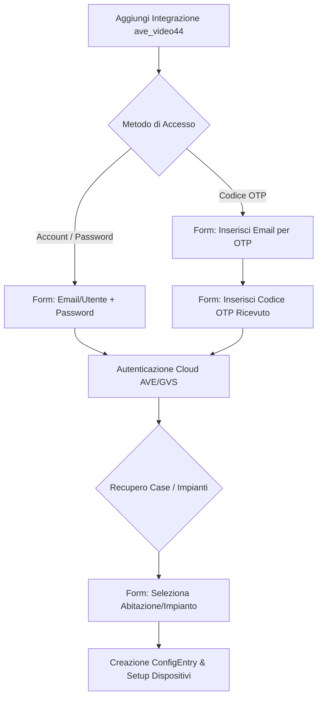
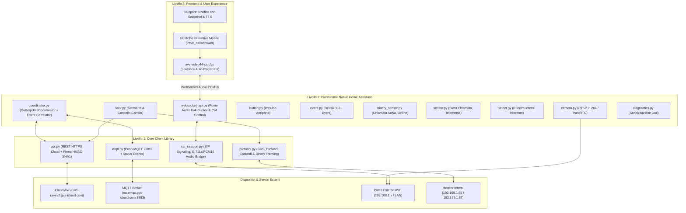

# Design Specification: Integrazione Home Assistant `ave_video44` (AVE Video V44 / GVS Intercom)

- **Document ID**: `SPEC-AVE-VIDEO44-HA-001`
- **Data**: 2026-10-24
- **Autore**: Federico / Antigravity Superpowers
- **Stato**: Approvato (Final Design Spec)
- **Target Platform**: Home Assistant Core >= 2024.1.0 (Standard HACS)
- **Repository Path**: `/home/federico/Ave-video44-HA`
- **Dominio Integrazione**: `ave_video44`

---

## 1. Visione del Progetto & Obiettivo

L'integrazione open-source **`ave_video44`** porta all'interno di Home Assistant il controllo completo, affidabile e a bassa latenza dei sistemi videocitofonici **AVE Video V44** (modelli *V44 EASY* e *V44 SMART*, inclusi i display interni `VI2F-PIT7WF`, `TS-SMART7xx`, `TS-SMART10xx` e i posti esterni AVE/GVS).

Il sistema OEM è prodotto da **Guangzhou Video-Star Electronics Co., Ltd. (GVS)** e opera secondo un'architettura ibrida:
1. **Cloud Control & Push Plane**: REST API HTTPS (`https://avev2.gvs-icloud.com`) e MQTT (`eu.emqx.gvs-icloud.com:8883`) per notifica degli eventi e comandi remoti.
2. **Local Device Plane**: Comunicazione su rete locale Ethernet/Wi-Fi via **SIP over TLS/TCP** su porta `5060`, **GVS Control Protocol** binario su porta UDP `8300` (magic header `GVSGVS\xa5\xa5\xa5\xa5`), stream audio RTP (codec **PCMA / G.711a 8kHz**) su UDP `8302` e video RTP (**H.264 Baseline**) su UDP `8303` o RTSP su porta `554`.

### 1.1. Requisiti Chiave
- **Zero Segreti o IP Cablati**: Nessun indirizzo IP, chiave crittografica o credenziale utente è presente hardcoded nel codice sorgente. Tutti i parametri sono acquisiti e persistiti unicamente tramite Home Assistant ConfigFlow, OptionsFlow e Storage API protetta.
- **Conformità Rigorosa agli Standard HACS**: Progetto strutturato ricalcando esattamente il gold standard adottato dall'utente in `/home/federico/Lepas` (`custom_components/ave_video44/`, `hacs.json`, `pyproject.toml`, test pytest completi).
- **Esperienza Utente Completa (UX)**: Ricezione notifiche con snapshot, annuncio vocale TTS, visualizzazione video istantanea, audio bidirezionale full-duplex via browser WebSocket e sblocco serrature in un clic.

---

## 2. Standard HACS & Struttura del Repository

La struttura delle directory adotta in modo fedele il modello organizzativo di `Lepas`:

```
Ave-video44-HA/
├── hacs.json
├── pyproject.toml
├── pytest.ini
├── requirements_test.txt
├── README.md
├── LICENSE
├── custom_components/
│   └── ave_video44/
│       ├── __init__.py
│       ├── manifest.json
│       ├── const.py
│       ├── config_flow.py
│       ├── coordinator.py
│       ├── entity.py
│       ├── lock.py
│       ├── button.py
│       ├── binary_sensor.py
│       ├── event.py
│       ├── sensor.py
│       ├── select.py
│       ├── camera.py
│       ├── diagnostics.py
│       ├── websocket_api.py
│       ├── core/
│       │   ├── __init__.py
│       │   ├── api.py
│       │   ├── mqtt.py
│       │   ├── protocol.py
│       │   └── sip_session.py
│       ├── frontend/
│       │   ├── ave-video44-card.js
│       │   └── card_loader.py
│       ├── blueprints/
│       │   └── incoming_call_notification.yaml
│       ├── translations/
│       │   ├── it.json
│       │   └── en.json
│       └── brand/
│           ├── icon.png
│           ├── icon@2x.png
│           ├── logo.png
│           └── logo@2x.png
└── tests/
    ├── __init__.py
    ├── conftest.py
    ├── test_config_flow.py
    ├── test_coordinator.py
    ├── test_lock.py
    └── test_protocol.py
```

### 2.1. Configurazione `hacs.json`
```json
{
  "name": "AVE Video V44",
  "render_readme": true,
  "homeassistant": "2024.1.0",
  "content_in_root": false
}
```

### 2.2. Configurazione `manifest.json`
```json
{
  "domain": "ave_video44",
  "name": "AVE Video V44",
  "codeowners": ["@federico"],
  "config_flow": true,
  "documentation": "https://github.com/federico/Ave-video44-HA",
  "issue_tracker": "https://github.com/federico/Ave-video44-HA/issues",
  "dependencies": ["http", "camera", "websocket_api"],
  "requirements": [
    "httpx>=0.27.0",
    "paho-mqtt>=2.0.0"
  ],
  "iot_class": "cloud_push",
  "version": "1.0.0"
}
```

---

## 3. Gestione ConfigFlow, OptionsFlow e Rubrica Interni

### 3.1. Flusso di Configurazione (`ConfigFlow`)
Il setup dell'integrazione è 100% guidato dall'interfaccia utente (UI) e supporta due modalità di autenticazione:



#### Step 1: Scelta Metodo di Accesso (`user_step`)
L'utente seleziona se autenticarsi con username/password oppure tramite OTP via email:
- `CONF_AUTH_METHOD`: `"password"` o `"otp"`.

#### Step 2A: Accesso con Password (`password_step`)
- `account`: Stringa (Email o Username dell'account AVE Video V44).
- `password`: Stringa mascherata. Il client esegue `SHA256(password)` in esadecimale minuscolo prima della trasmissione su HTTPS firmato con HMAC-SHA1.

#### Step 2B: Accesso con OTP (`otp_request_step` & `otp_verify_step`)
- `email`: Indirizzo email di registrazione.
- Invocazione dell'endpoint `/usercenter/api/uc/otp/request/email`.
- `code`: Codice numerico a 6 cifre ricevuto via email.

#### Step 3: Selezione Impianto (`select_home_step`)
- Il client interroga l'endpoint `/smarthome/api/user/home/getHomeList`.
- Se l'utente gestisce più impianti (es. "Casa Mare", "Villa Principale"), viene presentata una lista a scelta singola (`vol.In(homes_dict)`).
- Vengono acquisiti automaticamente i monitor interni e i posti esterni associati (`getDeviceList`).

### 3.2. Flusso Opzioni (`OptionsFlow`) & Rubrica Interni
L'integrazione fornisce una schermata di opzioni dedicata per configurare comportamenti avanzati e la **Rubrica Interni** per la comunicazione citofonica locale:

1. **Rubrica Interni (`address_book`)**:
   - Stringa formattata multilinea o dizionario chiave-valore nel formato:
     ```text
     1-1-101=Piano Terra
     1-1-102=Primo Piano
     1-1-103=Cugino
     ```
   - Ogni riga associa l'identificativo fisico di camera assegnato sul bus intercom GVS/AVE (`[Edificio]-[Scala]-[Appartamento]`) a un nome visualizzato amichevole.
2. **Durata Impulso Relè Apriporta (`unlock_pulse_duration`)**:
   - Intero in secondi (range 1-10s, default: `2`). Determina per quanti secondi l'entità `lock` rimane in stato `unlocked` prima di ripristinarsi automaticamente su `locked`.
3. **Stream Video Preferito (`preferred_video_stream`)**:
   - Opzioni: `"sub_stream"` (RTSP canale 1: risoluzione VGA/D1, bassissima latenza, ottimale per mobile) o `"main_stream"` (RTSP canale 0: 720p/1080p, qualità massima).
4. **Annuncio Vocale Automatico (`tts_auto_announce`)**:
   - Booleano (default: `true`). Notifica sui media player abilitati quando qualcuno suona al campanello.

---

## 4. Supporto Multi-Account e Multi-Monitor

Il sistema garantisce la piena coesistenza di scenari architetturali complessi:

### 4.1. Scenario 1: Più Monitor sotto lo Stesso Account
- L'utente possiede un monitor principale (*Master*, es. `TS-SMART7xx`) e uno o più monitor secondari (*Slave*) nella stessa abitazione.
- Il cloud GVS associa tutti i monitor al medesimo `homeId`.
- L'integrazione crea un unico `ConfigEntry`. Il `DataUpdateCoordinator` esegue la discovery e registra ciascun monitor fisico come dispositivo distinto in Home Assistant con le proprie entità (telemetria, connettività, stato chiamata).
- I comandi di apertura porta (`unlockV2`) vengono indirizzati al rispettivo posto esterno o attraverso il gateway designato.

### 4.2. Scenario 2: Monitor Distribuiti su Account Separati o Istanze HA Separate
- Esempio pratico:
  - 2 citofoni al Primo Piano registrati su un account AVE (es. eseguiti su istanza `VM 501`).
  - 1 citofono al Piano Terra registrato su un altro account AVE (es. su istanza `VM 106`).
- **Funzionamento Multi-Entry**: Home Assistant consente di istanziare due o più `ConfigEntry` distinte del dominio `ave_video44`, ciascuna autenticata con credenziali diverse.
- **Interfono `HOUSETOHOUSE` Indipendente dal Cloud**:
  - Il protocollo locale sui dispositivi fisici assegna a ciascun citofono un indirizzo hardware di stanza (es. `1-1-101` per il Piano Terra, `1-1-102` per il Primo Piano, `1-1-103` per l'appartamento adiacente).
  - La chiamata interfono tra appartamenti non transita per il cloud se eseguita su SIP locale: un monitor invia un SIP `INVITE` all'indirizzo `sip:1-1-102@<local_ip>:5060`.
  - In Home Assistant, tramite l'entità `select.intercom_target` (alimentata dalla **Rubrica Interni**), l'utente può selezionare "Cugino (1-1-103)" o "Piano Terra (1-1-101)" e lanciare la chiamata intercom.
  - La mappatura cross-account viene risolta a livello di registro condiviso `hass.data[DOMAIN]["address_book"]`, consentendo a tutte le entità di conoscere gli indirizzi fisici dell'intero impianto.

---

## 5. Architettura a 3 Livelli del Sistema



---

## 6. Specifica Dettagliata del Livello 1: `core/`

### 6.1. `core/protocol.py` (GVS Protocol Binary Framing & Constants)
Implementa il protocollo proprietario GVS/AVE su UDP porta `8300`:

#### Costanti di Framing
- **Header Magico (10 byte)**: `47 56 53 47 56 53 A5 A5 A5 A5` (`b"GVSGVS\xa5\xa5\xa5\xa5"`).
- **Porte di Servizio**:
  - `COMMON_PORT`: `8300` (Controllo, comandi, telemetria)
  - `CARD_PORT`: `8000` (Controllo tessere RFID)
  - `AUDIO_PORT`: `8302` (Flusso RTP audio PCMA/G.711a)
  - `VIDEO_PORT`: `8303` (Flusso RTP video H.264)
  - `FILE_PORT`: `8304` (File transfer)
- **Codici Funzione (`Function Code`)**:
  - `TALKBACK_FUNCTION = 3` (Chiamate interfono, risposta, monitoraggio)
  - `ENTRANCEGUARD_FUNCTION = 4` (Controllo accessi e apertura serratura)
  - `SECURITYALARM_FUNCTION = 5` (Segnalazione allarmi antintrusione)
  - `NOTICE_FUNCTION = 6` (Messaggi di servizio e avvisi)
  - `MANAGER_FUNCTION = 7` (Comunicazioni con postazione di portineria)
  - `LIFTLINK_FUNCTION = 8` (Interfacciamento ascensori)
  - `NETWORKUPDATE_FUNCTION = 32` (Aggiornamenti firmware OTA)
- **Codici Comando (`Command Code`)**:
  - `COM_PING_ASK = 1`, `COM_PING_REPLY = 129` (0x81)
  - `COM_VERSION_ASK = 2`, `COM_VERSION_REPLY = 130` (0x82)
  - `COM_TIME_ASK = 3`, `COM_TIME_REPLY = 4`
  - `COM_MONITOR_ASK = 4`, `COM_MONITOR_REPLY = 132` (0x84)
  - `COM_FAULT_ASK = 5`, `COM_FAULT_REPLY = 133` (0x85)
  - `COM_CHECK_FAULT_ASK = 6`, `COM_CHECK_FAULT_REPLY = 134` (0x86)
  - `COM_CHECK_MAC_ASK = 7`, `COM_CHECK_MAC_REPLY = 135` (0x87)
  - `COM_UNLOCK_ASK = 9`, `COM_UNLOCK_REPLY = 137` (0x89)
  - `COM_UNLOCK_REPORT_ASK = 10`, `COM_UNLOCK_REPORT_REPLY = 138` (0x8A)
  - `COM_REMOTE_UNLOCK_ASK = 11`, `COM_REMOTE_UNLOCK_REPLY = 139` (0x8B)
  - `COM_REMOTE_SNAP_ASK = 12`, `COM_REMOTE_SNAP_REPLY = 140` (0x8C)
  - `UNLOCK_RANDOM_ASK = 17`, `UNLOCK_RANDOM_REPLY = 145` (0x91)
  - `COM_ROOM_BY_CARD = 18`, `COM_ROOM_BY_CARD_REPLY = 146` (0x92)
  - `COM_CARD_REGISTER = 34`, `COM_CARD_REGISTER_REPLAY = 162` (0xA2)
  - `COM_HAND_ASK = 81`, `COM_HAND_REPLY = 82` (0x52)
  - `COM_VIDEO_ASK = 85` (0x55)
  - `COM_TIMECOUNTSYNC_ASK = 86`, `COM_TIMECOUNTSYNC_REPLY = 87` (0x57)
  - `COM_INTERCEPT_STAT_ASK = 88`, `COM_INTERCEPT_STAT_REPLY = 89` (0x59)
  - `COM_INTERCEPT_CALL_ASK = 90`, `COM_INTERCEPT_CALL_REPLY = 91` (0x5B)
  - `COM_CALL_SUSPEND_ASK = 92`, `COM_CALL_SUSPEND_REPLY = 93` (0x5D)
  - `COM_CALL_RECOVER_ASK = 94`, `COM_CALL_RECOVER_REPLY = 95` (0x5F)
  - `COM_CALL_TURN_ASK = 96`, `COM_CALL_TURN_REPLY = 97` (0x61)
  - `COM_CALL_RECORD_UPLOAD_ASK = 98`, `COM_CALL_RECORD_UPLOAD_REPLY = 99` (0x63)
- **Tipi Dispositivo (`devType`)**:
  - `DEV_UNKONW = 0`
  - `DEV_TEST = 1`
  - `DEV_PC = 17` (0x11)
  - `DEV_GUARD = 18` (0x12, identifier `"GUARD"`)
  - `DEV_PERIMETERGATE = 19` (0x13, identifier `"PERIMETERGATE"`)
  - `DEV_CARD = 20` (0x14)
  - `DEV_IPCAMERA = 21` (0x15)
  - `DEV_POWER = 22` (0x16)
  - `DEV_GUARDUINT = 49` (0x31, identifier `"GUARDUINT"`)
  - `DEV_DOORSTATION = 50` (0x32, identifier `"DOORSTATION"`)
  - `DEV_CARDUINT = 52` (0x34)
  - `DEV_ELEVOTAR = 53` (0x35)
  - `DEV_POWERUINT = 54` (0x36)
  - `DEV_INDOORPHONE = 97` (0x61, identifier `"IS"`)
  - `DEV_MINIOS = 98` (0x62, identifier `"MINIOS"`)
- **Tipi di Chiamata (`callType`)**:
  - `GATETOINDOOR = 0`
  - `MANAGETOINDOOR = 1`
  - `GATETOMANAGE = 2`
  - `HOUSETOHOUSE = 3`
  - `INDOORCALL = 4`
  - `INDOORRADIO = 5`
  - `MONITORING = 6`
  - `MINIOSCALL = 7`
  - `IPCAM_MONITORING = 8`

#### Layout del Frame Binario (Byte-by-Byte)
```
Offset    Dimensione    Tipo         Descrizione
0         10            bytes        Magic Header: 47 56 53 47 56 53 a5 a5 a5 a5
10        2             uint16_be    Lunghezza del blocco payload successivo (N)
12        1             uint8        Function ID (es. 4 per ENTRANCEGUARD, 3 per TALKBACK)
13        1             uint8        Command ID (es. 11 per COM_REMOTE_UNLOCK_ASK)
14        1             uint8        Source Device Type (es. 97 per DEV_INDOORPHONE 'IS')
15        6             bytes        Source Room Address (6 byte: edificio, scala, piano, alloggio, sub, res)
21        1             uint8        Dest Device Type (es. 50 per DEV_DOORSTATION)
22        6             bytes        Dest Room Address (6 byte)
28        N-16          bytes        Dati opzionali del comando (parametri/token)
12+N      2             uint16_be    CRC16 / Checksum di controllo (opzionale o 0x0000)
```

### 6.2. `core/api.py` (Client REST Cloud Asincrono)
Gestisce tutte le chiamate REST verso il cloud AVE/GVS:
- **Base URL**: `https://avev2.gvs-icloud.com/`
- **Credenziali Client Integrate**:
  - `tenantUuid`: `"c9613cbd-6872-49e8-833b-60ae37f4bfc5"`
  - `appUuid`: `"47c5dd01-5f4a-495b-a53a-6fe726839bdc"`
  - `appSecret`: `"E3AG3rdNEsDpXJ84UPQFggFb7BFK3R99"`
- **Algoritmo di Firma HMAC-SHA1 (`to_encryption`)**:
  ```python
  import hmac
  import hashlib
  import base64
  from typing import Dict, Any

  def sign_request_params(params: Dict[str, Any], secret: str = "E3AG3rdNEsDpXJ84UPQFggFb7BFK3R99") -> str:
      """Genera la firma HMAC-SHA1 conforme a StringUtil.toEncryption di AVE."""
      sorted_pairs = []
      for k in sorted(params.keys()):
          if k != "sign" and params[k] is not None:
              sorted_pairs.append(f"{k}={params[k]}")
      query_str = "&".join(sorted_pairs)
      mac = hmac.new(secret.encode("utf-8"), query_str.encode("utf-8"), hashlib.sha1).digest()
      # Base64 string convertita in minuscolo
      b64_str = base64.b64encode(mac).decode("utf-8")
      return b64_str.lower()
  ```

#### Endpoints Implementati
1. `POST /usercenter/api/uc/loginToGvs/account`: Login con password SHA256 (`account`, `password`, `channel: "App"`).
2. `POST /usercenter/api/uc/otp/request/email`: Richiesta codice OTP via email.
3. `POST /usercenter/api/uc/loginToGvs/email/otp`: Autenticazione con codice OTP a 6 cifre.
4. `GET /smarthome/api/user/home/getHomeList`: Elenco impianti/case associati all'utente.
5. `GET /smarthome/api/user/device/getDeviceList`: Elenco posti esterni, telecamere e monitor interni con `deviceId`, `deviceNumber`, `deviceName`.
6. `POST /smarthome/api/device-monitoring/unlock`: Comando di apertura serratura (`unlockV2`). Parametri: `deviceId`, `lockId` (`"1"` per pedonale, `"2"` per carraio), `monitoringDeviceNumber`, `ts`, `sign`.
7. `GET /smarthome/api/user/sip/getSipAccount`: Ottenimento estensione SIP cloud dinamica (`username`, `password`, `serverUrl`).
8. `GET /smarthome/api/user/rtsp/auth/config`: URL dello stream video RTSP live (`rtsp://open-sips.gvs-icloud.com:554/...`).

### 6.3. `core/mqtt.py` (Push Listener Asincrono)
Mantiene una connessione persistente TLS al broker MQTT per ricevere notifiche istantanee:
- **Broker Host**: `eu.emqx.gvs-icloud.com`
- **Porta**: `8883` (MQTTS over TLS)
- **Autenticazione**: Username/Password derivati dalla sessione GVS Cloud (`sessionId`).
- **Topic Sottoscritti**:
  - `smarthome/device/status` (Broadcast eventi stato impianto)
  - `smarthome/device/{deviceId}` (Eventi specifici di ciascun posto esterno e monitor)
- **Eventi Gestiti**:
  - `code: "monitoring"`, `action: 1`: Inizio chiamata/suoneria dal posto esterno (`CALL_IN`). Estrae `senderName`, `senderId`, `outDoorNum`, `targetId`.
  - `code: "monitoring"`, `action: 0`: Fine chiamata o chiusura comunicazione.
  - `code: "unlock"`: Conferma avvenuta apertura serratura con relè azionato.

### 6.4. `core/sip_session.py` (SIP Signaling & Audio Bridge)
Gestisce la sessione VoIP a bassa latenza e la traslazione dei formati audio:
- **Signaling SIP**:
  - Supporta **SIP over UDP** e **SIP over TLS/TCP** su porta `5060`.
  - Gestisce l'apertura porta durante la conversazione tramite SIP `INFO` con body JSON `application/gvs_protocol+json`:
    ```json
    {
      "req": "COM_REMOTE_UNLOCK_ASK",
      "reqsn": 1,
      "sip": "sip:1001@open-sips.gvs-icloud.com",
      "status": 1
    }
    ```
  - In alternativa invia il tono DTMF standard RFC 2833 per i posti esterni tradizionali.
- **Ponte Audio Bidirezionale (Audio Bridge)**:
  - **Downstream (Citofono -> Browser/Speaker)**: Stream RTP su UDP `8302` con campioni **PCMA (G.711a, 8kHz, 8-bit A-law)** -> Decodifica in **PCM16 Little-Endian** -> Trasmissione tramite WebSocket frame binari alla card Lovelace.
  - **Upstream (Microfono Browser -> Citofono)**: Stream WebSocket dal browser con frame PCM16 a 8kHz -> Codifica A-law (G.711a) -> Impacchettamento in pacchetti RTP (payload type 8, timestamp incrementale 160 per 20ms) -> Trasmissione via socket UDP verso la porta audio del posto esterno.

---

## 7. Specifica Dettagliata del Livello 2: Piattaforme Native Home Assistant

Ogni dispositivo monitor o posto esterno scoperto viene registrato nel Device Registry di Home Assistant con:
- `identifiers: {(DOMAIN, device_id)}`
- `name`: Nome del posto esterno (es. "Posto Esterno Ingresso") o monitor interno
- `manufacturer`: `"AVE / GVS"`
- `model`: Modello hardware rilevato (es. `"TS-SMART7"`, `"VI2F-PIT7WF"`)
- `sw_version`: Versione firmware rilevata

### 7.1. Piattaforma `lock.py`
Espone un'entità `LockEntity` per ciascuna serratura fisica collegata:
- **ID Entità**: `lock.posto_esterno_cancelletto_pedonale`, `lock.posto_esterno_cancello_carraio`
- **Attributi**: `lock_id` (`"1"` o `"2"`), `last_unlocked_by`, `lock_method` (`"cloud_api"` o `"sip_info"`)
- **Metodo `async_unlock()`**:
  1. Imposta lo stato su `unlocking`.
  2. Invia la richiesta `unlockV2` all'API cloud o invia il frame SIP `INFO`/UDP `COM_REMOTE_UNLOCK_ASK`.
  3. Imposta lo stato su `unlocked`.
  4. Avvia un timer asincrono pari a `unlock_pulse_duration` (default 2s), al termine del quale reimposta automaticamente lo stato su `locked`.

### 7.2. Piattaforma `button.py`
Espone pulsanti rapidi per l'azionamento impulsivo:
- **ID Entità**: `button.apri_cancelletto`, `button.apri_cancello_carraio`
- Esegue istantaneamente lo sblocco senza verificare lo stato di chiusura, ottimale per widget mobili e scorciatoie iOS/Android.

### 7.3. Piattaforma `event.py` & `binary_sensor.py`
- **`event.py`**:
  - `event_types: ["doorbell_press", "call_missed", "call_answered"]`
  - `device_class: EventDeviceClass.DOORBELL`
  - Genera l'evento standard `doorbell_press` al momento esatto in cui il visitatore preme il campanello.
- **`binary_sensor.py`**:
  - `binary_sensor.chiamata_in_corso`: `device_class: sound` (On durante lo squillo o la conversazione, Off a riposo).
  - `binary_sensor.connessione_online`: `device_class: connectivity` (Stato heartbeat e telemetria del citofono).

### 7.4. Piattaforma `sensor.py`
- `sensor.stato_chiamata`: Valori `idle`, `ringing`, `talking`, `monitoring`.
- `sensor.ultimo_chiamante`: Nome o ID dell'ultimo interno o posto esterno che ha avviato una chiamata.
- `sensor.durata_ultima_chiamata`: Durata della conversazione in secondi.

### 7.5. Piattaforma `select.py` (Rubrica Interni Intercom)
- **ID Entità**: `select.rubrica_interni`
- **Opzioni**: Popolate dinamicamente dalla **Rubrica Interni** (`address_book`) configurata nelle opzioni dell'integrazione (es. `["Piano Terra (1-1-101)", "Primo Piano (1-1-102)", "Cugino (1-1-103)"]`).
- **Servizio `ave_video44.call_intercom`**:
  - Accetta `target: "1-1-102"` o usa l'opzione selezionata.
  - Avvia la chiamata citofonica bidirezionale `HOUSETOHOUSE` verso l'interno selezionato.

### 7.6. Piattaforma `camera.py`
- Espone lo stream video live del posto esterno:
  - Streaming via RTSP (`rtsp://open-sips.gvs-icloud.com:554/...` o stream RTSP diretto del posto esterno `rtsp://<local_ip>:554/stream/1/`).
  - Codec supportato: **H.264 Baseline Profile**.
  - Piena compatibilità con `stream` di Home Assistant, HLS e WebRTC (`go2rtc`).

### 7.7. Piattaforma `diagnostics.py`
- Esporta i dati diagnostici in formato JSON mascherando tutti i dati sensibili:
  - Maschera con `***REDACTED***` i campi `password`, `sessionId`, `token`, `appSecret`, `sign`, `authorization`.
  - Riporta versione firmware, modello, latenza MQTT, contatori pacchetti SIP e stato porte di rete.

### 7.8. Modulo `websocket_api.py` (Audio Bridge & Controllo Chiamata)
Registra i comandi WebSocket personalizzati all'interno del server WebSocket nativo di Home Assistant:

#### 1. `ave_video44/call_control`
Consente al frontend di controllare la chiamata:
```json
{
  "id": 12,
  "type": "ave_video44/call_control",
  "entry_id": "01J9...",
  "device_id": "doorstation_001",
  "action": "answer" // "answer" | "hangup" | "reject" | "unlock" | "mute"
}
```

#### 2. `ave_video44/audio_subscribe`
Sottoscrizione del frontend ai pacchetti audio in arrivo dal citofono (Downstream):
- Il server invia messaggi binari WebSocket contenenti campioni PCM16 (8kHz, 16-bit mono little-endian) decodificati in tempo reale dai flussi PCMA G.711a.

#### 3. `ave_video44/audio_tx`
Invio di campioni audio dal microfono dello smartphone/browser verso il citofono (Upstream):
- Il frontend invia frame binari WebSocket PCM16.
- Il server converte i campioni in A-law G.711a e li trasmette al citofono via socket RTP UDP.

---

## 8. Specifica Dettagliata del Livello 3: Frontend & User Experience

### 8.1. Custom Card Lovelace: `ave-video44-card.js`
La card viene memorizzata in `custom_components/ave_video44/frontend/` e registrata automaticamente nelle risorse Lovelace all'avvio dell'integrazione (`card_loader.py`).

#### Modalità di Funzionamento della Card
1. **Modalità Riposo (`Idle State`)**:
   - Visualizzazione anteprima video con snapshot aggiornato o stream a basso bitrate.
   - Pulsanti rapidi: "Apri Cancelletto" e "Apri Cancello".
   - Dropdown "Chiama Interno" per selezionare un citofono dalla rubrica ed effettuare una chiamata interfono.
2. **Modalità Chiamata Attiva (`Ringing / In-Call State`)**:
   - Apertura automatica in pop-up a tutto schermo o overlay modale all'arrivo dell'evento `doorbell_press`.
   - Streaming video WebRTC/H.264 fluido a 25-30 fps.
   - Barra controlli ergonomica con pulsanti ad alto contrasto:
     - **Tasto Verde "Rispondi"**: Avvia l'acquisizione del microfono del dispositivo e la trasmissione audio full-duplex.
     - **Tasto Rosso "Rifiuta / Chiudi"**: Invia comando di riaggancio e chiude il pop-up.
     - **Tasto Giallo/Oro "Apri Porta"**: Aziona il relè apriporta senza interrompere la conversazione.
     - **Tasto "Muto"**: Sospende l'invio dell'audio microfonico.

#### Gestione Audio Microfonico WebRTC/Browser
La card utilizza l'API browser standard `navigator.mediaDevices.getUserMedia`:
```javascript
const stream = await navigator.mediaDevices.getUserMedia({
  audio: {
    channelCount: 1,
    sampleRate: 8000,
    echoCancellation: true,
    noiseSuppression: true,
    autoGainControl: true
  },
  video: false
});
```
Un `AudioWorklet` (o `ScriptProcessorNode`) esegue il downsampling a 8000 Hz a 16-bit PCM e invia i chunk binari ogni 20ms sulla WebSocket HA.

### 8.2. Deep Linking da Notifica Mobile
- La notifica inviata allo smartphone tramite l'App Home Assistant Companion include il parametro di deep link:
  `clickAction: "/lovelace/citofono?ave_call=answer&device_id=doorstation_001"`
- All'apertura della notifica, la card intercetta il query param `?ave_call=answer`, risponde istantaneamente alla chiamata attivando microfono e altoparlante in vivavoce e mostrando il video live senza richiedere ulteriori tocchi.

### 8.3. Blueprint: `incoming_call_notification.yaml`
Fornita come template automatizzato incluso nell'integrazione:

```yaml
blueprint:
  name: "Notifica Chiamata Videocitofono AVE Video V44"
  description: "Invia notifiche interattive con snapshot e riproduce annunci vocali quando qualcuno suona al campanello AVE."
  domain: automation
  input:
    doorbell_device:
      name: "Videocitofono AVE"
      selector:
        device:
          integration: ave_video44
    notify_devices:
      name: "Dispositivi Notifica (Smartphone)"
      selector:
        target:
          device:
    media_players:
      name: "Smart Speaker per Annuncio TTS (Opzionale)"
      default: []
      selector:
        target:
          entity:
            domain: media_player
    tts_message:
      name: "Messaggio Vocale"
      default: "Qualcuno sta suonando al videocitofono principale."
      selector:
        text:

trigger:
  - platform: event
    event_type: ave_video44_doorbell_press

action:
  # 1. Snapshot dalla telecamera
  - service: camera.snapshot
    target:
      entity_id: camera.posto_esterno_ingresso
    data:
      filename: /config/www/ave_doorbell_latest.jpg

  # 2. Notifica Smartphone con Actions e Deep Link
  - service: notify.notify
    data:
      title: "Campanello in Arrivo!"
      message: "Chiamata dal videocitofono AVE."
      data:
        image: "/local/ave_doorbell_latest.jpg"
        clickAction: "/lovelace/citofono?ave_call=answer"
        actions:
          - action: "OPEN_DOOR"
            title: "Apri Cancelletto"
          - action: "ANSWER_CALL"
            title: "Rispondi a Schermo"
          - action: "DISMISS"
            title: "Ignora"

  # 3. Annuncio TTS su Smart Speaker
  - choose:
      - conditions:
          - condition: template
            value_template: "{{ media_players | length > 0 }}"
        sequence:
          - service: tts.speak
            target:
              entity_id: tts.google_en_com
            data:
              media_player_entity_id: "{{ media_players }}"
              message: "{{ tts_message }}"
```

---

## 9. Sicurezza, Privacy & Validazione

1. **Gestione Segreti e Token**:
   - I token di sessione (`sessionId`), credenziali SIP e chiavi cloud non vengono mai memorizzati in chiaro nei log.
   - La maschera di diagnostica esclude sistematicamente qualsiasi dato biometrico, token, cookie o hash password.
2. **Isolamento della Rete**:
   - L'integrazione supporta il funzionamento ibrido: se l'istanza HA si trova nella stessa subnet locale dei citofoni (es. `192.168.1.0/24`), il flusso multimediale RTSP/SIP può essere configurato in modalità locale prioritaria, riducendo a zero il traffico verso internet e garantendo la riservatezza delle immagini all'interno della rete domestica.
3. **Resilienza e Riconnessione**:
   - Backoff esponenziale con jitter per il client MQTT e per il polling REST.
   - Gestione automatica del rinnovo del `sessionId` cloud alla ricezione di HTTP 401 o 403.
